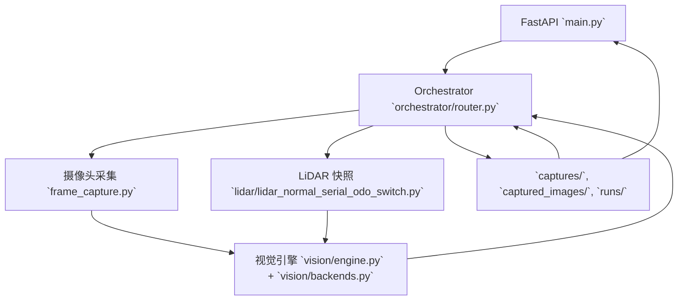

# VisionMate — 学术式项目报告

版本：main
日期：2025-11-27

作者：VisionMate 开发组（代码仓库分析自动生成）

摘要
----
VisionMate 是一个用于视障/盲人环境感知与避障辅助的多模态系统原型。系统整合了 RGB 摄像头、RPLIDAR、语音交互与多种本地推理模型（YOLOv8、MiDaS、EasyOCR），以 FastAPI 为控制接口，Orchestrator 为任务调度中枢，视觉推理模块提供目标检测、文字识别和相对深度估计，并与 LiDAR 快照进行启发式融合以产生粗略绝对深度与危险提示。本文档基于仓库源码、脚本与注释，系统性回顾设计、实现细节、评估指标、局限性与未来工作。

目录
----
1. 引言
2. 任务设置（Task Setting）
3. 背景与相关工作
4. 系统架构（System Overview）
5. 方法论（Methodology）
6. 开发与集成流程（Development Process）
7. 实施细节与算法（Algorithmic Details）
8. 数据与评估（Dataset & Evaluation）
9. 结果与产物（Results & Artifacts）
10. 挑战、鲁棒性与解决方案（Challenges & Solutions）
11. 局限性（Limitations）
12. 未来工作（Future Work）
13. 团队分工建议（Group Contributions）
14. 结论
15. 附录：关键文件索引与使用示例

1. 引言
----
现代辅助系统越来越依赖多模态感知来为视障用户提供环境理解与安全提示。VisionMate 旨在将常见的视觉感知（目标检测、OCR、深度估计）与廉价 LiDAR 设备结合，通过语音或文本接口向用户提供实时的环境提示。该系统针对课堂演示与研究原型场景设计，注重模块化、可复现性与跨平台兼容。

2. 任务设置（Task Setting）
----
2.1 系统目标
- 提供基于视觉与 LiDAR 的环境感知，并将检测与深度信息转化为自然语言提示，辅助视障用户识别前方障碍与关键信息（如文字）。
- 支持低延迟的交互式查询（通过 ASR 或文本），并在运行时产出可视化产物以便调试。

2.2 场景与用户需求
- 场景：室内/近距离室外，移动用户（盲人）询问“前方有什么/左边有什么/能否通过”等问题。
- 用户需求推断：实时性（延迟低于 1s 为宜）、鲁棒性（低光照/部分遮挡下仍能工作）、清晰的反馈（语音 + 图像），以及在传感器不可用时的 graceful fallback（本项目通过 `SIMULATION_MODE` 支持 stub 后端）。

2.3 输入/输出与功能边界
- 输入：语音（ASR→text）、RGB 图像（摄像头）、LiDAR 快照 (`runs/lidar_snapshot.json`)。
- 输出：`MCPResponse` JSON（含 `VisionResult`）、可选 TTS 音频文件、若干调试图像。
- 功能边界：系统为辅助/演示级别，不直接控制移动设备或执行安全关键动作（代码注释与实现均表明深度估计为启发式映射）。

3. 背景与相关工作
----
3.1 使用的技术栈与模型
- 目标检测：YOLOv8（`ultralytics.YOLO`）。选用 `yolov8n` 体现对推理速度与轻量化的偏好。
- 单目深度估计：MiDaS（支持 `MiDaS_small`, `DPT_Hybrid`, `DPT_Large`）。MiDaS 提供通用相对深度估计，适合无相机内参数的环境下快速部署。
- OCR：EasyOCR（`easyocr.Reader(['ch_sim','en'], gpu=...)`），用于读取场景中的文本信息。

3.2 多模态融合理论依据（概述）
- 在资源受限的交互系统中，后期（结果级）融合提供工程上的便利：各模型可独立并行推理，随后通过简单的规则或比例映射合并信息，减小对时间同步与外参准确性的依赖。

4. 系统架构（System Overview）
----
4.1 模块组成
- API 层：`main.py`（FastAPI），提供 `POST /api/v1/mcp`。
- Orchestrator：`orchestrator/router.py`，负责意图识别（规则优先、sklearn 兜底）、分辨率选择、调用 CV 引擎、收集 timings 并构建返回结果。
- 视觉引擎：`vision/engine.py`（`CVModuleProcess`） + `vision/backends.py`（`RealBackends` / `StubBackends`）。
- 摄像头采集：`frame_capture.py`，支持多分辨率与重试逻辑。
- LiDAR：`lidar/lidar_normal_serial_odo_switch.py`（读取点云并写入 snapshot，包含自动端口识别、里程计与警报逻辑）。

4.2 数据流
1. 语音或文本请求触发 API。
2. Orchestrator 做意图分类并决定采集策略。
3. 拍照并保存到 `captured_images/`；若有 LiDAR 快照，读取并传递到视觉模块。
4. 视觉模块并行运行检测、OCR、MiDaS 深度估计。
5. 深度后处理：相对深度投影→LiDAR 比例校准→注入到检测框。
6. 结果构建为 `VisionResult` 并返回/可选 TTS。

4.3 系统架构图



5. 方法论（Methodology）
----
5.1 选择理由（Why）
- YOLOv8n：因其实时性能与开箱即用的 API，适用于交互式演示与低延迟需求。相比更复杂的检测器（如 Faster R-CNN）具有更低推理延迟。
- MiDaS：可在无相机标定信息下输出相对深度，适合快速集成。其输出通过分位数归一与线性映射转换为近似绝对深度，满足演示与初步融合需求。
- 后期融合：通过在检测结果后注入深度，系统避免了对多模态时间同步与外参标定的强依赖，使工程实现更简单且模块化。
- 规则优先意图识别：保证课堂/演示用例稳定触发，降低对训练模型质量的依赖。
- 弱同步（文件快照）：以文件为共享介质并使用 TTL 控制时效，实现在硬件不稳定情况下的容错与易集成。

5.2 算法/实现要点
- MiDaS 相对深度映射：`linear_depth_projection` 使用 5%/95% 分位数界定最小/最大深度并线性映射到 [near, far]。优点：对异常像素有鲁棒性；缺点：无法恢复相机尺度。
- LiDaR 校准策略：取图像中心一段宽度的深度统计（10% 分位数）作为视觉 forward，若与 LiDAR forward 相差小于阈值（3m），按比例缩放整张深度；否则判定 mismatch。
- 框深度注入：在 box 的中心 50% 区域取有效深度的中位数作为该物体距离。

6. 开发与集成流程（Development Process）
----
6.1 代码演变与迭代证据
- `main.py` 中保留旧的 LLM 调用示例（注释），表明曾尝试更复杂的 LLM 驱动方案，后退为本地 Orchestrator 与规则/轻量模型的组合。
- 目录中大量脚本（`inspect_midas.py`, `debug_router_flow.py`, `visualize_latest.py`, `export_depth_maps.py`）显示逐步单元验证和调试的实践路线。

6.2 复现与试验建议
- 安装与依赖：使用 `environment.yml` 创建 conda 环境并激活。
- 权重：确保 `weights/` 中包含 `yolov8n.pt` 等必要文件。
- 快速验证：运行 `python debug_router_flow.py` 并观察 `runs/latest_status.json` 与可视化结果。

7. 实施细节与算法（Algorithmic Details）
----
7.1 YOLO 检测流程
- 加载权重：`YOLO(str(weights_path))`。
- 输出解析：`results.boxes` 中取 `xyxy, cls, conf` 转换为 `vision.types.Box`。

7.2 MiDaS 深度流程
- transform 适配：`_apply_midas_transform` 支持 transform 返回 dict 或 tensor，并尝试使用 numpy 输入以兼容不同实现。
- 推理步骤：把 transform 后的 tensor 送入模型并用 `F.interpolate` 调整为原图尺寸。

7.3 LiDAR 校准细节
- 统计策略：选择图像中心 1/3 宽度区域取 10% 分位作为视觉 forward，避免单个噪声点影响。
- 一致性判断：若视觉 forward 与 LiDAR forward 差距过大，则不校准并记录 `_depth_error`。

8. 数据与评估（Dataset & Evaluation）
----
8.1 可用数据资源
- `data/`：文本意图数据（`train.csv`, `dev.csv`, `test.csv`）用于训练意图分类器（`scripts/train_sklearn_intent.py`）。
- `lidar_frames/`：大量 CSV 文件为 LiDAR 扫描示例，适合离线算法测试。
- `captured_images/`, `runs/`：保存的 RGB 与深度结果可作为分析样本。

8.2 评估指标建议
- 意图：accuracy, F1, confusion matrix（`scripts/train_sklearn_intent.py` 已输出 classification report）。
- 检测：mAP@0.5、recall（若提供标注）。
- 深度：RMSE, AbsRel, 在 LiDAR 参考下的偏差分布。 
- 系统性能：端到端延迟（p50, p95），子阶段耗时（intent, capture, cv）。

9. 结果与产物（Results & Artifacts）
----
9.1 仓库内示例产物
- `runs/latest_status.json`：Orchestrator 每次运行落盘的摘要，示例字段包含 `intent`, `message`, `image_path`, `hazard_level`, `timings` 等。
- `runs/debug_yolo_input.jpg`, `runs/depth/*`：检测与深度可视化图像。
- `runs/lidar_snapshot.json`：LiDAR 快照样例。

9.2 性能数据
- Orchestrator 已在 `meta["timings"]` 中埋点（intent, capture, cv, total），但仓库没有长期统计结果；需要运行负载测试以得到 p50/p95 数据。

10. 挑战、鲁棒性与解决方案（Challenges & Solutions）
----
10.1 关键挑战
- 摄像头帧不稳定与亮度問題（解决：暖机、重试与亮度阈值）。
- LiDAR 串口与握手失败（解决：自动端口识别、握手重试、轻量重同步）。
- 深度模型接口多样（解决：动态检测 transform 返回类型并适配 numpy/tensor）。
- 模态时间同步缺失（权衡：采用快照 + TTL 的弱同步以保证简易性）。

10.2 代码证据
- 代码位置：`frame_capture._capture_with_retries`（亮度检测）、`lidar/handshake_port`（握手逻辑）、`vision/backends._apply_midas_transform`（transform 兼容性处理）。

11. 局限性（Limitations）
----
- 深度估计为启发式尺度映射，无法替代精确的相机内参 + 三角测量方法。 
- 时间同步为弱同步，可能导致多传感器读数之间出现短时不一致。
- 缺少检测/深度的标准化标注数据与评估流水线（YOLO 权重需外置）。

12. 未来工作（Future Work）
----
- 实施外参标定与时间同步；进行像素级融合以提高距离估计精度。 
- 引入模型优化（ONNX/TensorRT）以提升边缘部署性能。 
- 完善评估基线与数据集（添加标注、benchmark 脚本）。

13. 团队分工建议（Group Contributions）
----
- 视觉后端（YOLO/MiDaS/OCR 集成）——高优先级与高工作量。 
- LiDAR 驱动与融合（串口/里程计/快照）——复杂性最高。 
- Orchestrator 与路由（意图 + 流程控制）——中等复杂度。 
- ASR 前端与 TTS（客户端交互）——中等任务量。 
- 评估与部署（benchmark/Docker/优化）——中低，但长期收益大。

14. 结论
----
VisionMate 是面向教学与研究的完整多模态避障系统原型，提供模块化的 API、丰富的调试脚本与多模态融合示例。对于课程项目或毕业设计，它既能作为感知、融合与系统工程的实践平台，也能扩展为更高精度或边缘部署的研究基线。

附录 A：关键文件索引
----
- `main.py` — FastAPI 服务入口
- `orchestrator/router.py` — Orchestrator 实现
- `vision/backends.py`, `vision/engine.py` — 感知后端实现
- `frame_capture.py` — 摄像头采集
- `lidar/lidar_normal_serial_odo_switch.py` — LiDAR 采集与快照
- `scripts/export_depth_maps.py`, `visualize_latest.py` — 可视化/导出工具

附录 B：快速运行示例（PowerShell）
----
```powershell
conda env create -f environment.yml
conda activate visionmate
# 启动服务
uvicorn main:app --host 0.0.0.0 --port 9000
# 本地回环测试
python debug_router_flow.py
# 导出深度对比
python scripts/export_depth_maps.py --image captured_images/test.jpg --lidar-distance 2.0
```

END
